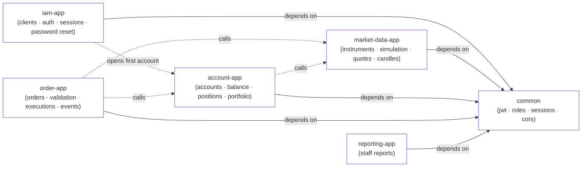
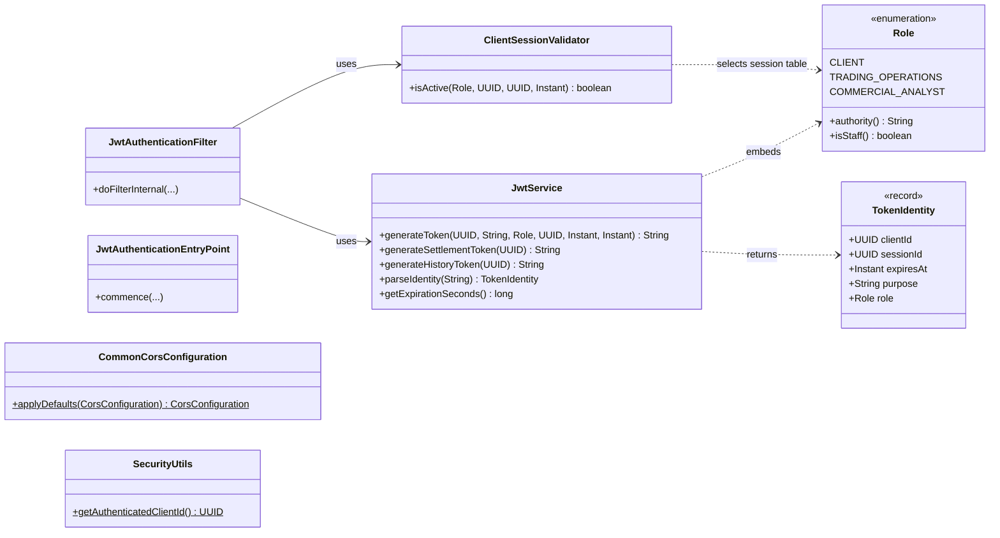
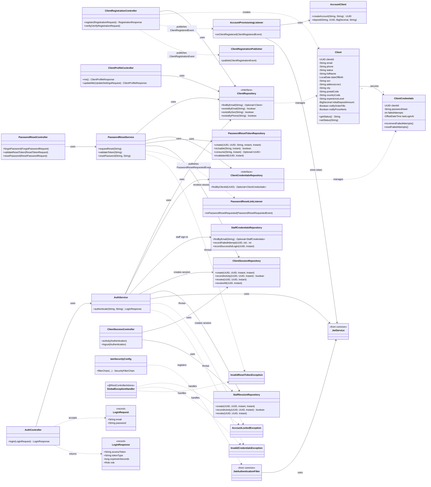
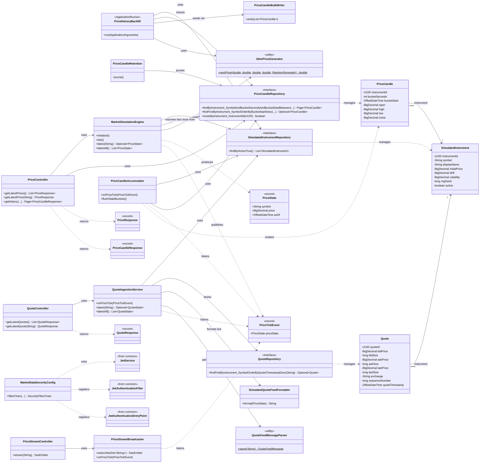
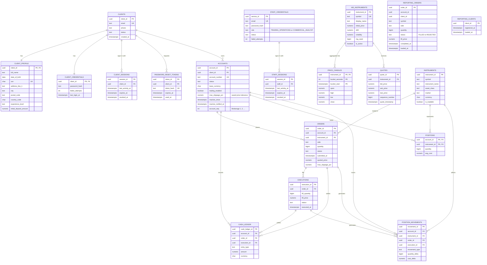

# leap-laugh-love

## Team Members
1. Scrum Master & Software Developer - Chris Musselman
2. Software Developer - Nikhil Akula
3. Software Developer - Yahia Elsaad
4. Tech Lead - Lauren Sanday
5. Software Developer - Elisa Paul

## Branching Strategy
Trunk-based development.

## [Documentation and Code Coverage](https://chrismuss04.github.io/leap-laugh-love/)

- **Javadoc**: [chrismuss04.github.io/leap-laugh-love/javadoc](https://chrismuss04.github.io/leap-laugh-love/javadoc/)
- **JaCoCo coverage**: [chrismuss04.github.io/leap-laugh-love/jacoco](https://chrismuss04.github.io/leap-laugh-love/jacoco/)
  - [account-app](https://chrismuss04.github.io/leap-laugh-love/jacoco/account-app/)
  - [common](https://chrismuss04.github.io/leap-laugh-love/jacoco/common/)
  - [iam-app](https://chrismuss04.github.io/leap-laugh-love/jacoco/iam-app/)
  - [market-data-app](https://chrismuss04.github.io/leap-laugh-love/jacoco/market-data-app/)
  - [order-app](https://chrismuss04.github.io/leap-laugh-love/jacoco/order-app/)
  - [reporting-app](https://chrismuss04.github.io/leap-laugh-love/jacoco/reporting-app/)

## Contents

- [Running the app](#running-the-app)
- [Architecture](#architecture)
- [UML class diagrams](#uml-class-diagrams)
- [API endpoints](#api-endpoints)
- [Roles, sessions and staff dashboards](#roles-sessions-and-staff-dashboards)
- [Testing](#testing)
- [CI, SonarQube and docs](#ci-sonarqube-and-docs)
- [Kafka and the reporting ETL](#kafka-and-the-reporting-etl)
- [Database](#database)
- [Price history and candle widths](#price-history-and-candle-widths)
- [Market hours](#market-hours)

---

## Running the app

### Quick start (Docker)

You only need Docker. Node, Java and Maven are not required.

1. Create your `.env` and set a JWT secret (any string of 32+ characters; Compose won't start without one):

   ```bash
   sed "s/^JWT_SECRET=$/JWT_SECRET=$(openssl rand -hex 32)/" .env.example > .env
   ```

   (Or `cp .env.example .env` and fill in the empty `JWT_SECRET=` line yourself.)

2. Start everything:

   ```bash
   docker compose up --build
   ```

   The first run takes a few minutes (image builds, `npm install`, a year of price history). Later starts take seconds.

3. Open **http://localhost:4200** and sign in with a seeded account (password `Password123!` for all):

| Email | Role | Lands on |
| --- | --- | --- |
| `alice.johnson@leap.com` | Client | Trading dashboard |
| `trading.ops@leap.com` | Trading operations (staff) | `/reporting` |
| `commercial.analyst@leap.com` | Commercial analyst (staff) | `/reporting` |

Emails the app sends (password reset, registration confirmation, fill notices, inactive accounts) go to Mailpit at **http://localhost:8025**. Nothing reaches a real inbox.

**Stopping:** `docker compose down`. Add `-v` to also wipe the database, Mailpit and the frontend's `node_modules`.

**After code changes:** frontend edits hot-reload. For backend changes, rebuild with `docker compose up -d --build <service>` (or just `--build` for all of them).

> [!NOTE]
> `.env.example` values are local-dev defaults, not secrets. Don't use them for a shared or deployed environment.

### What's running

| Service | URL / port |
| --- | --- |
| Frontend (Angular dev server) | http://localhost:4200 |
| iam-app | http://localhost:8081 |
| account-app | http://localhost:8082 |
| market-data-app | http://localhost:8083 |
| order-app | http://localhost:8084 |
| reporting-app | http://localhost:8085 |
| PostgreSQL (`paysprint` / `paysprint`, password `changeme`) | localhost:5432 |
| Mailpit UI | http://localhost:8025 |
| Kafka | `kafka:9092`, inside the Compose network only |
| reporting-etl, user-etl | no port |

The dev server proxies `/api/*` to the services (see `frontend/proxy.conf.js`). Each service has `GET /actuator/health`.

### Updating an existing database

Schema and seed files only run on an empty database. After pulling schema changes, either reset it:

```bash
docker compose down -v && docker compose up --build
```

or keep your data and apply the matching migration (each one is safe to rerun):

```bash
docker compose exec -T db psql -U paysprint -d paysprint -v ON_ERROR_STOP=1 < scripts/<migration>.sql
```

| Script | Adds |
| --- | --- |
| `migrate-client-sessions.sql` | `iam.client_sessions` (session timeout and revocation) |
| `migrate-staff-sessions.sql` | `iam.staff_sessions` |
| `migrate-password-reset-tokens.sql` | `iam.password_reset_tokens` |
| `migrate-registration-verification.sql` | Pending registrations for email-confirmed sign-up |
| `migrate-notification-preferences.sql` | `notify_order_fills`, `notify_price_alerts` |
| `migrate-price-tolerance.sql` | `max_slippage_pct` on accounts, quoted price and tolerance on orders |
| `migrate-order-types.sql` | Limit, stop and stop-limit orders; statuses `OPEN`, `CANCELLED`, `EXPIRED` |
| `migrate-trailing-stops.sql` | Trailing stops (run after `migrate-order-types.sql`) |
| `migrate-order-fill-notices.sql` | Fill email columns (run after `migrate-order-types.sql`) |
| `migrate-bracket-orders.sql` | Bracket order columns (run after `migrate-order-types.sql`) |
| `migrate-order-templates.sql` | `trading.order_templates` (run after `migrate-order-types.sql`) |
| `migrate-order-history-index.sql` | Index for order history sorting (optional) |
| `migrate-inactive-accounts.sql` | `trading.accounts.inactive_since` |
| `migrate-inactive-notification.sql` | `trading.accounts.inactive_notified_at` |
| `migrate-account-seq.sql` | `trading.accounts.account_seq`, numbered for existing accounts |
| `migrate-reporting-clients.sql` | `reporting.clients` |
| `migrate-reporting-order-outcomes.sql` | `CANCELLED` and `EXPIRED` in `reporting.orders` |
| `migrate-reporting-client-months.sql` | `reporting.client_months`, rebuilt from `reporting.orders` (rerun any time to rebuild) |
| `migrate-price-candles-key.sql` | New primary key on `marketdata.price_candles` (stop market-data-app first) |
| `migrate-market-hours.sql` | `extended_hours` and `collar_price` on orders (market hours) |

`reporting.orders` has no migration; it needs `docker compose down -v` once.

### Running the services without Docker

Use this when you want to run or debug a service from your IDE or terminal. Run every Maven command **from the repository root**: the services depend on the `common` module, which only resolves from the root.

1. Start a database. The easiest way is the Compose one, which creates and seeds itself:

   ```bash
   docker compose up -d db
   ```

   (Using your own PostgreSQL instead? Create a `paysprint` database and user with password `changeme`, then load `iam-app/src/main/resources/db/leap_laugh_love_schema.sql` followed by the `seed_*.sql` files in that folder, in the order `docker-compose.yml` mounts them.)

2. Install `common` and the parent POM once, and again whenever `common` changes:

   ```bash
   mvn -pl common -am install -DskipTests
   ```

3. Start each service in its own terminal:

   ```bash
   mvn -pl iam-app spring-boot:run
   mvn -pl account-app spring-boot:run
   mvn -pl market-data-app spring-boot:run
   REPORTING_EVENTS_ENABLED=false mvn -pl order-app spring-boot:run
   mvn -pl reporting-app spring-boot:run
   ```

   `REPORTING_EVENTS_ENABLED=false` stops order-app trying to reach Kafka, which isn't running. Emails will fail to send (and be logged) unless an SMTP server is listening on `localhost:1025`.

4. Start the frontend:

   ```bash
   cd frontend
   npm install
   npm start
   ```

The services default to `localhost:5432` with password `changeme` and a built-in dev JWT secret, so no environment variables are needed.

**Windows without Docker** (e.g. an EC2 instance that can't run Linux containers): with JDK 21+, Maven, Node.js and a local PostgreSQL installed, run from PowerShell:

```powershell
.\scripts\setup-windows-db.ps1   # once: creates and seeds the paysprint database
.\scripts\start-local.ps1        # builds and starts all six apps, opens the browser
.\scripts\stop-local.ps1         # stops them
```

`setup-windows-db.ps1` takes `-Reset` to rebuild the database and `-AppPassword` if your `DB_PASSWORD` isn't `changeme`. `start-local.ps1` reads `DB_PASSWORD` and `JWT_SECRET` from `.env` if it exists, and takes `-SkipBuild` and `-LightHistory` (one month of price history instead of a year, so the first start is much faster). For market hours, `-MarketSession PRE_MARKET|REGULAR|AFTER_HOURS|CLOSED` pins a session for a demo (add `-MarketOpensInMinutes 3` to have the market open after three minutes) and `-AlwaysOpen` turns market hours off; both also read `MARKET_HOURS_*` from `.env`.

### Using an external PostgreSQL with Docker

To keep the data off a small VM disk, the Compose services can use a PostgreSQL elsewhere, e.g. on the Windows host. This needs Docker Compose v2.24.4+.

1. On Windows, create and seed the database: `.\scripts\setup-windows-db.ps1`
2. Let the VM connect:
   - `postgresql.conf` (e.g. `C:\Program Files\PostgreSQL\18\data`): `listen_addresses = '*'`
   - `pg_hba.conf`: `host  paysprint  paysprint  172.20.0.0/16  scram-sha-256` (use your VM's network)
   - Restart PostgreSQL: `Restart-Service postgresql-x64-18`
   - Open the firewall (as administrator): `New-NetFirewallRule -DisplayName "PostgreSQL from VM" -Direction Inbound -Protocol TCP -LocalPort 5432 -RemoteAddress 172.20.0.0/16 -Action Allow`
3. In the VM's `.env`:

   ```bash
   COMPOSE_FILE=docker-compose.yml:docker-compose.external-db.yml
   EXTERNAL_DB_HOST=192.168.1.50   # the Windows host's IP as seen from the VM
   ```

   On WSL2 the host is the default gateway: `ip route show default | awk '{print $3}'`. Check the connection with `nc -zv "$EXTERNAL_DB_HOST" 5432`.

4. `docker compose up -d --build`. To switch back, remove `COMPOSE_FILE` from `.env`. The old volume can be removed with `docker volume rm leap-laugh-love_db_data`.

### Trying out email features locally

- **Password reset:** submit "Forgot password" for a registered email, then open the link in Mailpit. It works once and expires after 30 minutes.
- **Registration:** "Create account" sends a confirmation link (valid 24 hours). Following it creates the client and their first account. The sign-up page always says "check your email": a taken email, phone number or SSN is only ever revealed by email.
- **Inactive accounts:** the check runs nightly at 02:00 UTC. Henry Taylor's second account is seeded as flagged and not yet emailed. To trigger it sooner, add this to `.env` and run `docker compose up -d account-app`:

  ```bash
  ACCOUNT_INACTIVITY_CRON=0 */2 * * * *   # every 2 minutes
  ```

  Each account is emailed only once per inactive period.

If the browser reaches the frontend somewhere other than `http://localhost:4200`, set `PASSWORD_RESET_LINK_BASE_URL` and `REGISTRATION_LINK_BASE_URL` in `.env`.

---

## Architecture

A multi-module Maven project (five Spring Boot services plus a shared library), an Angular frontend and a Python ETL. Docker Compose runs them together with PostgreSQL, Kafka and Mailpit.

| Component | Port | Responsibility |
| --- | --- | --- |
| `common` | - | Shared library: JWT handling (`JwtService`, `JwtAuthenticationFilter`), the `Role` model, per-request session checks (`ClientSessionValidator`), 401 responses (`JwtAuthenticationEntryPoint`), CORS (`CommonCorsConfiguration`), plus code several services share: `MarketDataPriceClient`, `BaseAccount` / `BaseInstrument` / `BasePositionMovement` entity superclasses, `AccountRestClientConfig` and `BaseGlobalExceptionHandler`. |
| `iam-app` | 8081 | Registration, client and staff sign-in, JWTs, sessions, password reset, client profile and notification settings. Opens and funds the first account through account-app and publishes `client-register` to Kafka. |
| `account-app` | 8082 | Accounts and trade settings, cash balances, deposits, withdrawals, transfers, holdings, portfolio history, and the validation/settlement endpoints order-app calls. Nightly inactive-account check and email. |
| `market-data-app` | 8083 | Simulated prices (Geometric Brownian Motion, no external feed), quotes, OHLC candle history and an SSE price stream. |
| `order-app` | 8084 | Order validation, execution and history. Market, limit, stop, stop-limit and trailing-stop orders, brackets, templates and fill emails. Publishes finished orders to `order-events`. |
| `reporting-app` | 8085 | Commercial analyst reports, read from the `reporting` schema. `COMMERCIAL_ANALYST` only. |
| `frontend` | 4200 | Angular client trading app and the staff `/reporting` area. |
| `reporting-etl` | - | Python consumers that load `order-events` and `client-register` into `reporting.orders` and `reporting.clients`. Runs as the `reporting-etl` and `user-etl` Compose services. |

```mermaid
flowchart TB
    UI["Angular frontend (4200)<br/>client trading UI + staff /reporting"]

    subgraph PARENT["Parent Aggregator POM (leap-laugh-love-app)"]
        subgraph SEC["common (Shared Library)"]
            JwtS["JwtService, JwtAuthenticationFilter<br/>& ClientSessionValidator"]
            JwtEP["JwtAuthenticationEntryPoint"]
            CorsCfg["CommonCorsConfiguration"]
        end

        subgraph IAM["iam-app (Port 8081)"]
            IamApp["IamApplication @Import(JwtService)"]
            IamSec["IamSecurityConfig"]
            AuthC["AuthController<br/>/api/iam/auth/login"]
            PwC["PasswordResetController<br/>/api/iam/auth/*-password"]
            RegC["ClientRegistrationController<br/>/api/iam/v1/clients/register"]
            ProfC["ClientProfileController<br/>/api/iam/v1/clients/me"]
            SessC["ClientSessionController<br/>/api/iam/session"]
            AcctProv["AccountProvisioningListener<br/>(first account + deposit)"]
            RegPub["ClientRegistrationPublisher"]
            ResetMail["PasswordResetLinkListener"]
        end

        subgraph ACCOUNT["account-app (Port 8082)"]
            AccountApp["AccountApplication @Import(JwtService) @EnableScheduling"]
            AccountSec["AccountSecurityConfig (CORS Enabled)"]
            BalC["BalanceController<br/>/api/account/balance"]
            TransC["TransferController<br/>/api/account/balance/transfers"]
            AcctC["AccountController<br/>/api/account/accounts"]
            PosC["PositionController<br/>/api/account/accounts/{id}/positions"]
            PortC["PortfolioController<br/>/api/account/portfolio/history"]
            SettleC["AccountSettlementController<br/>/api/account/internal/accounts/{id}"]
            PHC["PriceHistoryClient<br/>(REST to market-data-app)"]
            InactDet["InactiveAccountDetector<br/>(nightly @Scheduled)"]
            InactNot["InactiveAccountNotifier"]
        end

        subgraph ORDER["order-app (Port 8084)"]
            OrderApp["OrderApplication @Import(JwtService)"]
            OrderSec["OrderSecurityConfig (CORS Enabled)"]
            OrderSubC["OrderSubmissionController<br/>/api/order/orders"]
            OrderHistC["OrderHistoryController<br/>/api/order/orders/history"]
            OpenOrdC["OpenOrderController & OrderStreamController<br/>/api/order/orders/open, /{id}, /cancel, /stream"]
            TriggerEng["OrderTriggerEngine<br/>(1s @Scheduled: fills open orders at their price)"]
            BracketSvc["BracketService<br/>(one exit cancels the other)"]
            TemplateC["OrderTemplateController<br/>/api/order/templates"]
            FillMailer["OrderFillMailer<br/>(15s @Scheduled sweep, JavaMailSender)"]
            QuoteSvc["CurrentQuoteService<br/>(non-stale quote at execution)"]
            AcctClient["AccountClient<br/>(REST to account-app)"]
            FillRec["PendingFillRecovery &<br/>SeededFillService"]
            OrderEvPub["OrderEventPublisher"]
        end

        subgraph MARKETDATA["market-data-app (Port 8083)"]
            MdApp["MarketDataApplication @Import(JwtService) @EnableScheduling"]
            MdSec["MarketDataSecurityConfig (CORS Enabled)"]
            SimEngine["MarketSimulationEngine<br/>(GBM @Scheduled tick)"]
            QuoteIngest["QuoteIngestionService<br/>(tick -> validated quote)"]
            CandleAcc["PriceCandleAccumulator<br/>(ticks -> OHLC candles)"]
            PriceC["PriceController<br/>/api/marketdata/prices"]
            StreamC["PriceStreamController<br/>/api/marketdata/stream (SSE)"]
            QuoteC["QuoteController<br/>/api/marketdata/quotes"]
        end

        subgraph REPORTING["reporting-app (Port 8085)"]
            RepApp["ReportingApplication @Import(JwtService)"]
            RepSec["ReportingSecurityConfig (CORS Enabled)<br/>COMMERCIAL_ANALYST only"]
        end
    end

    subgraph PG["PostgreSQL"]
        IAM_DB[("iam schema")]
        TRADING_DB[("trading schema")]
        MARKETDATA_DB[("marketdata schema")]
        REPORTING_DB[("reporting schema")]
    end

    subgraph MSG["Messaging & mail"]
        KAFKA["Kafka<br/>order-events · client-register"]
        MAIL["Mailpit (SMTP, UI on 8025)"]
    end

    subgraph ETL["reporting-etl (Python)"]
        OrderEtl["reporting-etl<br/>order-events consumer"]
        UserEtl["user-etl<br/>client-register consumer"]
    end

    UI -->|"HTTP / JSON (8081)"| IamSec
    UI -->|"HTTP / JSON (8082)"| AccountSec
    UI -->|"HTTP / JSON (8084)"| OrderSec
    UI -->|"HTTP / JSON / SSE (8083)"| MdSec
    UI -->|"HTTP / JSON (8085)"| RepSec

    IamSec --> AuthC
    IamSec --> PwC
    IamSec --> RegC
    IamSec --> ProfC
    IamSec --> SessC
    RegC -->|"after commit"| AcctProv
    RegC -->|"after commit"| RegPub
    AcctProv -->|"HTTP / JSON (8082)<br/>create account, deposit"| AcctC
    PwC -->|"after commit"| ResetMail
    ResetMail -->|SMTP| MAIL
    RegPub -->|"client-register"| KAFKA

    AccountSec --> BalC
    AccountSec --> TransC
    AccountSec --> AcctC
    AccountSec --> PosC
    AccountSec --> PortC
    AccountSec --> SettleC
    PortC --> PHC
    PHC -->|"HTTP / JSON (8083)<br/>caller's JWT forwarded"| PriceC
    InactDet --> InactNot
    InactNot -->|SMTP| MAIL

    OrderSec --> OrderSubC
    OrderSec --> OrderHistC
    OrderSubC --> AcctClient
    FillRec --> AcctClient
    AcctClient -->|"HTTP / JSON (8082)<br/>pre-trade & settlement"| SettleC
    OrderSubC --> QuoteSvc
    QuoteSvc -->|"HTTP / JSON (8083)<br/>caller's JWT forwarded"| QuoteC
    OrderSubC --> OrderEvPub
    FillRec --> OrderEvPub
    OrderEvPub -->|"order-events"| KAFKA

    MdSec --> PriceC
    MdSec --> StreamC
    MdSec --> QuoteC
    SimEngine --> PriceC
    SimEngine --> StreamC
    SimEngine --> QuoteIngest
    SimEngine --> CandleAcc
    QuoteIngest --> QuoteC

    KAFKA --> OrderEtl
    KAFKA --> UserEtl
    OrderEtl --> REPORTING_DB
    UserEtl --> REPORTING_DB

    IamApp -. "Library Dependency" .-> JwtS
    AccountApp -. "Library Dependency" .-> JwtS
    OrderApp -. "Library Dependency" .-> JwtS
    MdApp -. "Library Dependency" .-> JwtS
    RepApp -. "Library Dependency" .-> JwtS
    RepSec -. "reads" .-> REPORTING_DB

    AuthC --> IAM_DB
    PwC --> IAM_DB
    RegC --> IAM_DB
    ProfC --> IAM_DB
    SessC --> IAM_DB
    JwtS -. "session lookup" .-> IAM_DB
    BalC --> TRADING_DB
    TransC --> TRADING_DB
    AcctC --> TRADING_DB
    PosC --> TRADING_DB
    PortC --> TRADING_DB
    SettleC --> TRADING_DB
    InactDet --> TRADING_DB
    OrderSubC --> TRADING_DB
    OrderHistC --> TRADING_DB
    FillRec --> TRADING_DB
    CandleAcc --> MARKETDATA_DB
    QuoteIngest --> MARKETDATA_DB
```



---

## UML class diagrams

Entities, repositories, services and controllers per module. Test sources, DTO getters and DTO records are left out. Classes from the `common` module are marked `<<from common>>`. The frontend and `reporting-etl` are not shown.

**Legend:** solid arrow (`-->`) = association / field reference · dashed arrow (`..>`) = dependency (calls / uses) · `<<interface>>` = Spring Data repository.

### Reactor overview



### Common — `common`

`com.leap.leaplaughlove.common.security`: JWT creation and validation, the role model, per-request session checks, the request filter, the 401 entry point and shared CORS config. The `common` module also holds code more than one service uses (`MarketDataPriceClient`, the `Base*` entity superclasses, `AccountRestClientConfig`, `BaseGlobalExceptionHandler`); those are not drawn here.



### Identity & Access — `iam-app`

`com.leap.leaplaughlove.iam.{client, auth, session, staff, account, events, security, common}`: client registration (`PB-02`), client and staff sign-in with BCrypt and a failed-attempt lockout, JWT issuing, revocable sessions, password reset by email. On registration it opens the client's first account and publishes a Kafka event.



### Market Data — `market-data-app`

`com.leap.leaplaughlove.marketdata.{instrument, simulation, ingestion, history, stream, api}`: GBM price simulation on a scheduler, validated bid/ask/last quotes per tick, an SSE price stream, and OHLC candles at several widths. See [Price history and candle widths](#price-history-and-candle-widths).



### Account & Portfolio — `account-app`

`com.leap.leaplaughlove.account.{account, balance, ledger, position, portfolio, settlement, inactivity, client, instrument, quote, security}`: trading accounts and trade settings, the cash ledger, deposits, withdrawals and transfers, positions, portfolio value history, the nightly inactive-account check and email, and the internal validation and settlement endpoints order-app calls. `ClientStatus` is a read-only view of `iam.clients`.

```mermaid
classDiagram
    direction LR

    class Account {
        -UUID accountId
        -UUID clientId
        -String accountNumber
        -String status
        -String baseCurrency
        -boolean tradingEnabled
        -BigDecimal maxSlippagePercent
        -OffsetDateTime createdAt
        -OffsetDateTime inactiveSince
        -OffsetDateTime inactiveNotifiedAt
    }
    class CashLedgerEntry {
        -UUID cashLedgerId
        -UUID accountId
        -UUID orderId
        -UUID executionId
        -String entryType
        -BigDecimal amount
        -String currency
        -OffsetDateTime createdAt
        -String description
    }
    class Position {
        -UUID accountId
        -UUID instrumentId
        -long quantity
        -BigDecimal avgCost
        -OffsetDateTime updatedAt
    }
    class PositionId {
        <<composite key>>
        -UUID accountId
        -UUID instrumentId
    }
    class PositionMovement {
        -UUID movementId
        -UUID accountId
        -UUID instrumentId
        -UUID orderId
        -UUID executionId
        -String movementType
        -long quantityDelta
        -BigDecimal costDelta
    }
    class Instrument {
        -UUID instrumentId
        -String symbol
        -String instrumentName
        -String assetClass
    }
    class ClientStatus {
        <<read-only view>>
        -UUID clientId
        -String status
        -String email
    }
    class AccountRepository {
        <<interface>>
        +findByClientIdAndStatus(UUID, String) List~Account~
        +findByAccountIdAndClientId(UUID, UUID) Optional~Account~
        +findByInactiveSinceIsNotNullAndInactiveNotifiedAtIsNull() List~Account~
    }
    class CashLedgerRepository {
        <<interface>>
        +sumAmountsByAccountIds(List~UUID~) List~AccountTotal~
        +sumAmountByAccountIdAndCurrency(UUID, String) BigDecimal
    }
    class PositionRepository {
        <<interface>>
        +findPositionsByAccountId(UUID) List~PositionRow~
    }
    class PositionMovementRepository {
        <<interface>>
        +findByAccountIdAndInstrumentId(UUID, UUID) List~PositionMovement~
    }
    class InstrumentRepository {
        <<interface>>
    }
    class ClientStatusRepository {
        <<interface>>
    }
    class AccountAuthorizationService {
        +getAuthorizedAccount(UUID) Account
        +getAuthorizedTradingAccountForUpdate(UUID) Account
    }
    class AccountService {
        +createAccount(CreateAccountRequest) Account
        +updateTradeSettings(UUID, TradeSettingsRequest) Account
    }
    class AccountController {
        +createAccount(CreateAccountRequest) AccountSummary
        +getAccountsForClient() List~AccountSummary~
        +getAccount(UUID) AccountSummary
        +updateTradeSettings(UUID, TradeSettingsRequest) AccountSummary
    }
    class BalanceService {
        +getBalanceForClient() BalanceResponse
        +deposit(UUID, CashMovementRequest) CashTransactionResponse
        +withdraw(UUID, CashMovementRequest) CashTransactionResponse
    }
    class BalanceController {
        +getBalance() BalanceResponse
        +deposit(UUID, CashMovementRequest) CashTransactionResponse
        +withdraw(UUID, CashMovementRequest) CashTransactionResponse
    }
    class TransferService {
        +transfer(CashTransferRequest) CashTransferResponse
    }
    class TransferController {
        +transfer(CashTransferRequest) CashTransferResponse
    }
    class PositionService {
        +getPositionsForAuthenticatedClientAccount(UUID) PositionsResponse
    }
    class PositionController {
        +getPositionsForAccount(UUID) PositionsResponse
    }
    class PortfolioHistoryService {
        +getHistory(PortfolioRange) PortfolioHistoryResponse
    }
    class PortfolioController {
        +getHistory(String) PortfolioHistoryResponse
    }
    class PriceHistoryClient {
        +fetchCloses(String, OffsetDateTime, OffsetDateTime, int) List~CandleClose~
        +fetchLatestPrice(String) Optional~BigDecimal~
    }
    class AccountSettlementService {
        +getValidationData(UUID, UUID) AccountValidationDto
        +settleOrder(UUID, SettlementRequest) SettlementResponse
    }
    class AccountSettlementController {
        +getValidationData(UUID, UUID) AccountValidationDto
        +settle(UUID, SettlementRequest) SettlementResponse
    }
    class InactiveAccountDetector {
        +detect()
    }
    class InactiveAccountNotifier {
        +onInactivityChecked(InactivityCheckedEvent)
        +notifyClients() int
    }
    class AccountSecurityConfig {
        +filterChain(...) SecurityFilterChain
    }
    class JwtService { <<from common>> }
    class JwtAuthenticationFilter { <<from common>> }
    class JwtAuthenticationEntryPoint { <<from common>> }

    Account "1" --> "many" CashLedgerEntry : ledger
    Position ..> PositionId : identified by
    AccountRepository ..> Account : manages
    CashLedgerRepository ..> CashLedgerEntry : manages
    PositionRepository ..> Position : manages
    PositionMovementRepository ..> PositionMovement : manages
    InstrumentRepository ..> Instrument : manages
    ClientStatusRepository ..> ClientStatus : reads
    AccountAuthorizationService --> AccountRepository : uses
    AccountService --> AccountRepository : uses
    AccountService --> ClientStatusRepository : uses
    AccountService --> AccountAuthorizationService : uses
    AccountController --> AccountService : uses
    AccountController --> AccountAuthorizationService : uses
    AccountController --> AccountRepository : uses
    BalanceService --> AccountRepository : uses
    BalanceService --> CashLedgerRepository : uses
    BalanceService --> AccountAuthorizationService : uses
    BalanceController --> BalanceService : uses
    TransferService --> AccountAuthorizationService : uses
    TransferService --> CashLedgerRepository : uses
    TransferService --> BalanceService : uses
    TransferController --> TransferService : uses
    PositionService --> AccountRepository : uses
    PositionService --> PositionRepository : uses
    PositionController --> PositionService : uses
    PortfolioHistoryService --> AccountRepository : uses
    PortfolioHistoryService --> PositionRepository : uses
    PortfolioHistoryService --> PositionMovementRepository : uses
    PortfolioHistoryService --> CashLedgerRepository : uses
    PortfolioHistoryService --> PriceHistoryClient : prices history
    PortfolioController --> PortfolioHistoryService : uses
    AccountSettlementService --> AccountAuthorizationService : uses
    AccountSettlementService --> BalanceService : uses
    AccountSettlementService --> CashLedgerRepository : uses
    AccountSettlementService --> PositionRepository : uses
    AccountSettlementController --> AccountSettlementService : uses
    InactiveAccountDetector --> AccountRepository : flags
    InactiveAccountDetector ..> InactiveAccountNotifier : InactivityCheckedEvent
    InactiveAccountNotifier --> AccountRepository : uses
    InactiveAccountNotifier --> ClientStatusRepository : uses
    AccountSecurityConfig ..> JwtService : uses
    AccountSecurityConfig ..> JwtAuthenticationFilter : registers
    AccountSecurityConfig ..> JwtAuthenticationEntryPoint : registers
```



### Order Management — `order-app`

`com.leap.leaplaughlove.order.{order, execution, submission, history, working, notification, template, validation, instrument, position, account, client, quote, events, security}`: pre-trade validation, order submission, execution against live quotes, the position movements audit trail and order history. Calls account-app for validation and settlement and market-data-app for quotes. Background jobs finish interrupted fills and book the seeded history; every finished order is published to Kafka.

- **Order types.** `MARKET` fills at once at the ask (buy) or bid (sell). `LIMIT`, `STOP`, `STOP_LIMIT` and `TRAILING_STOP` orders wait `OPEN` and reserve the cash or shares they need (`ReservationService`). `OrderTriggerEngine` checks every quote once a second and fills reached orders through the same path as a market order (`OrderSubmissionService.fillOpenOrder`). A slower pass expires `DAY` orders at midnight US Eastern and `GTC` orders after 90 days. Open orders can be edited (`PATCH`) or cancelled.
- **Bracket orders.** A buy can carry `bracketTakeProfitPrice` and `bracketStopLossPrice`. When it fills, `FillRecorder.completeFill` opens a GTC `LIMIT` sell at the take-profit and a `STOP` sell at the stop-loss, linked by `oco_group_id` and `parent_order_id`. The first to execute cancels the other (`BracketService`). A quantity edit applies to both legs; cancelling one by hand leaves the other as a normal order.
- **Order templates.** Saved ticket setups as percent offsets from the market (`trading.order_templates`, max 20 per client).
- **Fill emails.** `OrderFillMailer` runs every 15 seconds and emails clients when a waiting order fills, is refused or expires, if their `notify_order_fills` setting is on. Failed sends retry on the next run. Settings: `SPRING_MAIL_HOST`, `SPRING_MAIL_PORT`, `ORDER_NOTIFICATIONS_EMAIL_ENABLED`, `ORDER_NOTIFICATIONS_EMAIL_FROM`, `ORDER_NOTIFICATIONS_HISTORY_URL`.
- **Single instance only.** `OrderTriggerEngine` and `OrderFillMailer` assume one order-app. To run more, claim rows with `SELECT ... FOR UPDATE SKIP LOCKED` or elect a leader.

```mermaid
classDiagram
    direction LR

    class Order {
        -UUID orderId
        -UUID accountId
        -String accountNumber
        -Instrument instrument
        -Side side
        -Long quantity
        -Status status
        -OffsetDateTime submittedAt
        -OffsetDateTime acceptedAt
        -OffsetDateTime rejectedAt
        -OffsetDateTime filledAt
        -String rejectionReason
        -BigDecimal quotedPrice
        -BigDecimal maxSlippagePercent
    }
    class Side { <<enumeration>> BUY SELL }
    class Status { <<enumeration>> SUBMITTED ACCEPTED REJECTED FILLED }
    class Execution {
        -UUID executionId
        -Order order
        -Long fillQuantity
        -BigDecimal fillPrice
        -Status status
        -OffsetDateTime executedAt
        -String reason
    }
    class PositionMovement {
        -UUID movementId
        -UUID accountId
        -Instrument instrument
        -UUID orderId
        -UUID executionId
        -MovementType movementType
        -Long quantityDelta
        -BigDecimal costDelta
        -OffsetDateTime createdAt
    }
    class Instrument {
        -UUID instrumentId
        -String symbol
        -String instrumentName
        -String assetClass
        -String market
        -String currency
        -boolean tradable
    }
    class OrderRepository {
        <<interface>>
        +findByAccountIdInOrderBySubmittedAtDescOrderIdDesc(Collection~UUID~, Pageable) Page~Order~
    }
    class ExecutionRepository {
        <<interface>>
        +findByOrder_OrderIdIn(Collection~UUID~) List~Execution~
    }
    class PositionMovementRepository {
        <<interface>>
    }
    class InstrumentRepository {
        <<interface>>
        +findBySymbol(String) Optional~Instrument~
    }
    class AccountRepository {
        <<interface>>
    }
    class OrderSubmissionService {
        +submitOrder(OrderSubmissionRequest) OrderSubmissionResponse
    }
    class OrderSubmissionController {
        +submitOrder(OrderSubmissionRequest) OrderSubmissionResponse
    }
    class FillRecorder {
        +recordExecution(Order, BigDecimal, OffsetDateTime) Execution
        +settle(Order, Execution, String) SettlementResponse
        +completeFill(Order, Execution) boolean
    }
    class PendingFillRecovery {
        +run()
    }
    class SeededFillService {
        +start()
    }
    class OrderHistoryService {
        +getOrderHistory(UUID, int, int, Integer, Integer, Integer) Page~OrderHistoryItem~
    }
    class OrderHistoryController {
        +getOrderHistory(int, int, Integer, Integer, Integer) Page~OrderHistoryItem~
    }
    class TradeValidationService {
        +validateTrade(AccountValidationDto, Instrument, ...) TradeValidationResult
        +checkPriceTolerance(BigDecimal, BigDecimal, ...) TradeValidationResult
    }
    class AccountClient {
        +getValidationData(UUID, UUID) AccountValidationDto
        +settleOrder(UUID, SettlementRequest) SettlementResponse
        +settleOrderAs(UUID, SettlementRequest, String) SettlementResponse
        +getAccountIdsForClient() List~UUID~
    }
    class CurrentQuoteService {
        +getCurrentQuote(String) QuoteSnapshot
    }
    class CurrentQuoteClient {
        +fetchLatest(String) Optional~QuoteSnapshot~
    }
    class PriceHistoryClient {
        +fetchCloses(String, OffsetDateTime, OffsetDateTime, int) List~CandleClose~
        +fetchLatestPrice(String) Optional~BigDecimal~
    }
    class OrderEventPublisher {
        +publishFilled(Order, Execution)
        +publishRejected(Order)
        +publishCancelled(Order)
        +publishExpired(Order)
    }
    class OrderTriggerEngine {
        +run()
        +expire()
        +evaluateOpenOrders() int
    }
    class BracketService {
        +cancelSiblings(UUID, UUID) int
    }
    class OpenOrderService {
        +listOpen(UUID) List~OpenOrderItem~
        +cancel(UUID, UUID) OpenOrderItem
        +expireDue() int
    }
    class OrderModificationService {
        +modify(UUID, UUID, ModifyOrderRequest) OpenOrderItem
    }
    class OrderFillMailer {
        +run()
        +notifyClients() int
    }
    class OrderTemplateService {
        +list(UUID) List~OrderTemplateItem~
        +create(UUID, OrderTemplateRequest) OrderTemplateItem
        +delete(UUID, UUID)
    }
    class OrderCompletedEvent {
        <<record>>
    }
    class OrderTemplateRepository {
        <<interface>>
    }
    class OrderSecurityConfig {
        +filterChain(...) SecurityFilterChain
    }
    class JwtService { <<from common>> }
    class JwtAuthenticationFilter { <<from common>> }
    class JwtAuthenticationEntryPoint { <<from common>> }

    Order --> Instrument : instrument
    Order --> Side
    Order --> Status
    Execution --> Order : order
    PositionMovement --> Instrument : instrument
    OrderRepository ..> Order : manages
    ExecutionRepository ..> Execution : manages
    PositionMovementRepository ..> PositionMovement : manages
    InstrumentRepository ..> Instrument : manages
    OrderSubmissionService --> OrderRepository : uses
    OrderSubmissionService --> ExecutionRepository : uses
    OrderSubmissionService --> InstrumentRepository : uses
    OrderSubmissionService --> AccountClient : uses
    OrderSubmissionService --> CurrentQuoteService : uses
    OrderSubmissionService --> TradeValidationService : uses
    OrderSubmissionService --> FillRecorder : uses
    OrderSubmissionService --> OrderEventPublisher : uses
    OrderSubmissionController --> OrderSubmissionService : uses
    OrderTriggerEngine --> OrderSubmissionService : fills open orders
    OrderTriggerEngine --> OpenOrderService : expires orders
    OrderModificationService --> OpenOrderService : locks the order
    FillRecorder --> BracketService : cancels the other exit
    FillRecorder --> OrderRepository : opens a bracket's exits
    BracketService --> OrderRepository : locks the group
    OrderFillMailer ..> OrderRepository : sweeps notice_pending
    OrderTemplateService --> OrderTemplateRepository : uses
    FillRecorder --> ExecutionRepository : uses
    FillRecorder --> PositionMovementRepository : uses
    FillRecorder --> AccountClient : settles via
    PendingFillRecovery --> OrderRepository : finds stuck orders
    PendingFillRecovery --> AccountRepository : uses
    PendingFillRecovery --> FillRecorder : uses
    PendingFillRecovery --> OrderEventPublisher : uses
    PendingFillRecovery --> JwtService : mints settlement token
    SeededFillService --> OrderRepository : uses
    SeededFillService --> FillRecorder : uses
    SeededFillService --> PriceHistoryClient : prices at fill time
    SeededFillService --> OrderEventPublisher : uses
    SeededFillService --> JwtService : mints settlement and history tokens
    OrderEventPublisher --> AccountRepository : resolves client
    OrderEventPublisher ..> OrderCompletedEvent : sends to Kafka
    OrderHistoryService --> OrderRepository : uses
    OrderHistoryService --> ExecutionRepository : uses
    OrderHistoryService --> AccountClient : uses
    OrderHistoryController --> OrderHistoryService : uses
    CurrentQuoteService --> CurrentQuoteClient : uses
    OrderSecurityConfig ..> JwtService : uses
    OrderSecurityConfig ..> JwtAuthenticationFilter : registers
    OrderSecurityConfig ..> JwtAuthenticationEntryPoint : registers
```



---

---

## API endpoints

Protected endpoints require the `CLIENT` role unless the Auth column says otherwise. `SERVICE` is an internal role that backend jobs use when calling another service; it is never issued to users.

| Module | Endpoint | Description | Permitted / Auth |
|---|---|---|---|
| **IAM** | `POST /api/iam/auth/login` | Sign in as a client or as staff (trading operations, commercial analyst); returns a JWT carrying the role | Permitted |
| **IAM** | `POST /api/iam/v1/clients/register` | Apply for an account; always `202` with the same body, whether or not the email, phone number or SSN is already registered. The applicant is emailed a confirmation link, or why no account was opened | Permitted |
| **IAM** | `POST /api/iam/v1/clients/register/verify` | Confirm the applicant's email with the token from that link, which opens the client and their first account; `400 INVALID_VERIFICATION_LINK` if it is unknown, expired, used, or its details have since been registered | Permitted |
| **IAM** | `POST /api/iam/auth/forgot-password` | Request a password reset link; always `204`, whether or not the email is registered | Permitted |
| **IAM** | `POST /api/iam/auth/reset-password/validate` | Check that a reset link's token is still usable, without spending it; `400 INVALID_RESET_TOKEN` if not | Permitted |
| **IAM** | `POST /api/iam/auth/reset-password` | Set a new password with the token from the reset link; `400 INVALID_RESET_TOKEN` if it is unknown, expired or used | Permitted |
| **IAM** | `GET /api/iam/v1/clients/me` | Get the signed-in client's profile and notification preferences | Bearer JWT (client) |
| **IAM** | `PUT /api/iam/v1/clients/me` | Update the signed-in client's profile and notification preferences | Bearer JWT (client) |
| **IAM** | `POST /api/iam/session/activity` | Record user activity, keeping the session from timing out as idle | Bearer JWT (client or staff) |
| **IAM** | `POST /api/iam/session/logout` | End the session; its token stops working immediately | Bearer JWT (client or staff) |
| **IAM** | `GET /actuator/health` | IAM service health check | Permitted |
| **Account** | `GET /api/account/accounts` | Get client trading accounts | Bearer JWT (client) |
| **Account** | `POST /api/account/accounts` | Open an additional trading account | Bearer JWT (client) |
| **Account** | `GET /api/account/accounts/{id}` | Get specific trading account | Bearer JWT (client) |
| **Account** | `PUT /api/account/accounts/{id}/trade-settings` | Save the account's price tolerance (`max_slippage_pct`) | Bearer JWT (client) |
| **Account** | `GET /api/account/accounts/{id}/positions` | Get holdings/positions for account. Each position has `quantityAtOpen` and `todayCashFlow` (since midnight UTC) for an exact day change; `closedToday` lists positions sold off today | Bearer JWT (client) |
| **Account** | `GET /api/account/balance` | Get balances for authenticated client | Bearer JWT (client) |
| **Account** | `POST /api/account/balance/accounts/{id}/deposit` | Deposit funds | Bearer JWT (client) |
| **Account** | `POST /api/account/balance/accounts/{id}/withdrawal` | Withdraw funds | Bearer JWT (client) |
| **Account** | `POST /api/account/balance/transfers` | Transfer cash between the client's own accounts | Bearer JWT (client) |
| **Account** | `GET /api/account/portfolio/history` | Portfolio value over time; `range` selects the period (default `1M`; `1D` runs from midnight UTC), optional `accountId` charts one account. Ranges start no earlier than the account opened, and `change` leaves out deposits and withdrawals (`netContributions`) | Bearer JWT (client) |
| **Account** | `GET /api/account/internal/accounts/{id}/validation-data` | Pre-trade validation data (account status, cash balance, holding in the instrument, saved price tolerance) for order-app | Bearer JWT (client or service) |
| **Account** | `POST /api/account/internal/accounts/{id}/settlement` | Settle a filled order against cash and positions; called by order-app | Bearer JWT (client or service) |
| **Account** | `GET /actuator/health` | Account service health check | Permitted |
| **Order** | `POST /api/order/orders` | Place an order (BUY/SELL). `orderType` is `MARKET` (default, fills at once), `LIMIT`, `STOP`, `STOP_LIMIT` or `TRAILING_STOP`; the others wait `OPEN` for their price (`limitPrice`, `stopPrice`, `trailAmount`/`trailPercent`, `timeInForce` `DAY`/`GTC`). A BUY may carry `bracketTakeProfitPrice` and `bracketStopLossPrice`. A `MARKET` order outside regular hours is queued `OPEN` for the next open with a 5% `collarPrice`; a `LIMIT` order may set `extendedHours` to also fill in pre-market and after-hours (see [Market hours](#market-hours)) | Bearer JWT (client) |
| **Order** | `GET /api/order/orders/open` | The client's open orders across accounts, newest first | Bearer JWT (client) |
| **Order** | `PATCH /api/order/orders/{id}` | Change an open order's quantity, limit or stop price, trail or time in force; on a bracket's exit, the quantity changes on both legs | Bearer JWT (client) |
| **Order** | `POST /api/order/orders/{id}/cancel` | Cancel an open order, releasing the cash or shares it held; `409` if it already filled | Bearer JWT (client) |
| **Order** | `GET /api/order/orders/stream` | Server-Sent-Events push of open orders that ended on their own: filled, refused or expired | Bearer JWT (client) |
| **Order** | `GET /api/order/templates` | The client's saved order templates, newest first | Bearer JWT (client) |
| **Order** | `POST /api/order/templates` | Save a template as percent offsets from the market; `409` for a duplicate name or past 20 | Bearer JWT (client) |
| **Order** | `DELETE /api/order/templates/{id}` | Delete one of the client's templates | Bearer JWT (client) |
| **Order** | `GET /api/order/orders/history` | Paginated order history (`page`, `size`); optional `year`, `month` and `day` narrow it to a date | Bearer JWT (client) |
| **Order** | `GET /actuator/health` | Order service health check | Permitted |
| **Market Data** | `GET /api/marketdata/prices` | Latest simulated price for every active instrument (503 S&P 500 constituents plus the index/benchmark symbols) | Bearer JWT (client) |
| **Market Data** | `GET /api/marketdata/instruments` | Instrument metadata, latest prices and performance; `period=today` (default), `week`, or `month` | Bearer JWT (client) |
| **Market Data** | `GET /api/marketdata/prices/{symbol}` | Latest simulated price for one instrument | Bearer JWT (client) |
| **Market Data** | `GET /api/marketdata/prices/{symbol}/history` | Paginated OHLC candle history; `interval` selects the candle width in seconds (`60`, `300`, `3600`, `86400`, default `60`) | Bearer JWT (client or service) |
| **Market Data** | `GET /api/marketdata/quotes` | Latest ingested quote (bid, ask, last, sizes) for every instrument | Bearer JWT (client) |
| **Market Data** | `GET /api/marketdata/quotes/{symbol}` | Latest ingested quote for one instrument; order-app uses it to price and stale-check orders | Bearer JWT (client) |
| **Market Data** | `GET /api/marketdata/market/status` | The market session now (`PRE_MARKET`, `REGULAR`, `AFTER_HOURS`, `CLOSED`), when it next changes, when regular trading next opens, and today's hours | Bearer JWT (client) |
| **Market Data** | `GET /api/marketdata/stream` | Server-Sent-Events push of live price ticks (optional `?symbols=` filter) | Bearer JWT (client) |
| **Market Data** | `GET /actuator/health` | Market data service health check | Permitted |
| **Reporting** | `GET /api/reporting/analyst/scorecard` | Volume, filled orders, average trade value, active clients and registrations per month, each with month-over-month and year-over-year % change | Bearer JWT (commercial analyst) |
| **Reporting** | `GET /api/reporting/analyst/client-activity` | Active clients per month split into new, returning and reactivated, with clients who lapsed | Bearer JWT (commercial analyst) |
| **Reporting** | `GET /api/reporting/analyst/retention` | Cohort matrix: each sign-up month's % of clients active in each month after | Bearer JWT (commercial analyst) |
| **Reporting** | `GET /api/reporting/analyst/activation` | Each sign-up month's % ordering within 30 days and ever, and median days to a first order | Bearer JWT (commercial analyst) |
| **Reporting** | `GET /api/reporting/analyst/concentration` | Share of each month's volume from the top 1, 10 and 20% of trading clients | Bearer JWT (commercial analyst) |
| **Reporting** | `GET /api/reporting/analyst/order-sizes` | Filled orders per month by value band, with mean and median order value | Bearer JWT (commercial analyst) |
| **Reporting** | `GET /actuator/health` | Reporting service health check | Permitted |

---

## Roles, sessions and staff dashboards

### Roles

Everyone signs in through `POST /api/iam/auth/login`. IAM checks clients first, then staff (`iam.reporting_service_credentials`). The JWT's `role` claim is one of:

| Role | Who | Home page | Backend access |
| --- | --- | --- | --- |
| `CLIENT` | Registered traders | `/dashboard` | All client-facing trading APIs |
| `TRADING_OPERATIONS` | Staff auditing orders | `/reporting` | None of the trading APIs (see below) |
| `COMMERCIAL_ANALYST` | Staff reporting on business activity | `/reporting` | None of the trading APIs (see below) |

Every client-facing API requires `CLIENT`, so staff tokens are refused there. Staff accounts are seeded, not created in the app. order-app's background jobs (`PendingFillRecovery`, `SeededFillService`) mint short-lived `SERVICE` tokens that work on a single endpoint each.

After 3 failed sign-ins, a client or staff account is `LOCKED`.

### Sessions

Each sign-in creates a row in `iam.client_sessions` or `iam.staff_sessions`, and the JWT carries its id (`sid`). The `common` filter checks the session on every request and rejects the token if the session is:

- **revoked** (`POST /api/iam/session/logout`),
- **expired** (the JWT lifetime, `app.jwt.expiration-minutes`, default 60), or
- **idle for over 10 minutes.** The frontend calls `POST /api/iam/session/activity` while the user is active and signs them out when either limit passes.

### Staff dashboards

Staff use `/reporting`, a separate shell from the trading UI. Each role gets its own dashboard, and clients who open `/reporting` are redirected home.

| Role | Route | Page |
| --- | --- | --- |
| `TRADING_OPERATIONS` | `/reporting` | **Order Audit**: orders submitted, filled, rejected and awaiting execution, with audit filters |
| `TRADING_OPERATIONS` | `/reporting/orders/:orderId` | **Order lifecycle**: one order retraced through its executions and the cash and holdings ledgers |
| `COMMERCIAL_ANALYST` | `/reporting` | **Trading Activity**: headline tiles for a period (1W, 1M, 3M, YTD, 1Y or custom); the **activity report** by instrument, with its own dates and daily or weekly breakdown; and six **12-month reports**: monthly scorecard, client activity, activation, retention by sign-up month, volume from top clients and orders by value |

> [!NOTE]
> The Order Audit panels and the analyst's headline tiles are placeholders (layout and filters, no data yet). The activity report and the six 12-month reports are live.

### Analyst reports (`reporting-app`)

Six reports under `/api/reporting/analyst/` (see [API endpoints](#api-endpoints)). Each covers the **last 12 complete UTC months**, takes no parameters, and returns one entry per month, zeros included.

- **Active client:** had at least one order execute in the month (FILLED or REJECTED). Volume and order value count FILLED orders only (quantity × fill price).
- **Client activity:** *new* = first active month; *returning* = also active the month before; *reactivated* = active before, but not last month; *lapsed* = active last month, not this one.
- **Retention:** cohorts are sign-up months, tracked from month 0 to the end of the window.
- **Activation:** time to the first executed order. A cohort is `complete: false` until 30 days after its month ends.
- **Concentration:** clients ranked by filled value each month; top slices round up to a whole client.
- **Order sizes:** bands are under 1,000 · 1,000–4,999.99 · 5,000–9,999.99 · 10,000–24,999.99 · 25,000+.
- **Changes** (scorecard) are `null` when the earlier figure is zero or before the data starts.

To fill the reports on a fresh local stack, load 24 months of synthetic data (**dev only**; rerunning adds nothing):

```bash
docker compose exec -T db psql -U paysprint -d paysprint -v ON_ERROR_STOP=1 < scripts/seed-reporting-history.sql
```

---

## Testing

### Backend (Maven)

From the repository root:

```bash
mvn clean verify                  # all modules
mvn -pl common test               # one module
mvn -pl order-app -am test        # a service (-am builds common first)
```

Don't run `mvn` from inside a service folder: it fails with *Could not resolve dependencies ... common:jar:0.1.0*.

### Frontend (Vitest)

```bash
cd frontend
npx playwright install chromium   # first time only
npx ng test --watch=false --coverage
```

Specs run in headless Chromium. Coverage goes to `frontend/coverage/leap-laugh-love-frontend/` (HTML plus `lcov.info` for SonarQube). Use `--include='src/app/instruments/*.spec.ts'` to run a subset.

### End-to-end (Playwright)

Start the stack with the E2E overlay, which adds the test users, then run the suite:

```bash
docker compose -f docker-compose.yml -f docker-compose.e2e.yml up -d --build
cd e2e && npm install && npx playwright install chromium
npm test            # or: npm run test:smoke, npm run test:ui
```

See [e2e/README.md](e2e/README.md) for running without Docker, writing new tests, and the separate market hours suite (`npm run test:market-hours`), which needs a stack pinned to one session.

### Reporting ETL (pytest)

```bash
cd reporting-etl
python -m venv .venv && . .venv/bin/activate   # Windows: .venv\Scripts\activate
pip install -r requirements-dev.txt
pytest
```

The database tests only run when `REPORTING_TEST_DB_URL` points at a Postgres loaded with the schema (as in CI).

### Pipeline scripts (Linux/macOS, against the Docker stack)

```bash
bash scripts/test-order-events.sh           # order -> Kafka -> reporting.orders (--fresh to reset first, --down to tear down after)
bash scripts/test-client-events.sh          # registration -> Kafka -> reporting.clients, including replay
bash scripts/test-trade-recovery.sh         # trade recovery, see docs/trade-record-resilience.md
```

---

## CI, SonarQube and docs

### Jenkins

The [Jenkinsfile](Jenkinsfile) runs on every push:

| Stage | What it does |
| --- | --- |
| Checkout, Configure Pipeline, Pull Images, Start Database | Workspace setup, choose optional stages, start the database |
| Build and Test → Frontend | Install dependencies, build the Angular app, prepare the test image |
| Build and Test → Unit Tests | `mvn test` with JaCoCo, plus the `reporting-etl` pytest suite |
| Build and Test → Service Stack | Build images, validate the schema and seeds, start the services, check health |
| Frontend Unit Tests | Vitest in headless Chromium, with coverage |
| Verify → Static Analysis | SonarQube analysis and Quality Gate |
| Verify → Stack Tests | Playwright E2E |

`main` and pull requests run everything. Feature-branch pushes skip E2E and SonarQube. The trade recovery tests are not part of CI; run them by hand as [docs/trade-record-resilience.md](docs/trade-record-resilience.md) describes.

### SonarQube

Jenkins analyses `main` and pull requests into the project `LeapLaughLove-Project` and fails the build if the Quality Gate fails. Settings are in [sonar-project.properties](sonar-project.properties). The token is the Jenkins credential `sonarqube-token` and is never committed.

One-time setup:

- **SonarQube:** create the project, restore the classroom quality profiles (Java, TypeScript `texoma-typescript-profile.xml`, JavaScript, HTML, CSS, Docker) and assign them with the classroom Quality Gate. Add a webhook named `Jenkins` pointing at `http://host.docker.internal:8080/sonarqube-webhook/`, or the Quality Gate stage will time out.
- **Jenkins:** install the *SonarQube Scanner* plugin, add the token as *Secret text* with ID `sonarqube-token`, add a SonarQube server named `SonarQube` (*Manage Jenkins → System*) and a scanner named `SonarScanner` (*Manage Jenkins → Tools*).

To analyse locally (needs Node on the PATH):

```bash
mvn test
(cd frontend && npx ng test --watch=false --coverage)
sonar-scanner -Dsonar.host.url=http://localhost:9000 -Dsonar.token=<your token>
```

### Javadoc and coverage site

`mvn test` writes JaCoCo reports to each module's `target/site/jacoco`. For Javadoc locally, run `mvn compile javadoc:javadoc` (add `-pl iam-app -am` for one module).

To publish the [GitHub Pages site](https://chrismuss04.github.io/leap-laugh-love/) from the `gh-pages` branch:

```bash
git switch gh-pages
git merge main
mvn clean test prepare-package -Pdocs    # writes docs/jacoco/<module>/ and docs/javadoc/
git add docs/
git commit -m "docs: update javadoc and jacoco coverage reports"
git push origin gh-pages
```

The `-Pdocs` build applies the dark theme from `docs-theme/` (landing page, JaCoCo and Javadoc stylesheets), using the same tokens as `frontend/src/styles.css`. Edit the files there rather than the generated output, and add a section to `docs-theme/site/jacoco/index.html` when a module is added.

---

## Kafka and the reporting ETL

Kafka runs single-node (KRaft) and is only reachable inside the Compose network at `kafka:9092`. `kafka-init` creates the `order-events` and `client-register` topics (3 partitions each) at startup. To look at them:

```bash
docker compose exec kafka /opt/kafka/bin/kafka-topics.sh --bootstrap-server localhost:9092 --list
docker compose exec kafka /opt/kafka/bin/kafka-console-consumer.sh --bootstrap-server localhost:9092 --topic order-events --from-beginning
```

### `order-events` → `reporting.orders`

- **Publisher:** order-app's `OrderEventPublisher` sends one JSON message per finished order, keyed by `orderId`, after the transaction commits. That covers live orders, `PendingFillRecovery` and `SeededFillService`. A failed send is logged and never fails the trade. Known gap: an event is lost if order-app stops between commit and send (a transactional outbox would fix this). `REPORTING_EVENTS_ENABLED=false` turns publishing off.
- **Contract:** `eventId`, `orderId`, `accountId`, `clientId`, `instrumentId`, `symbol`, `side`, `quantity`, `status` (`FILLED`, `REJECTED`, `CANCELLED` or `EXPIRED`), `fillPrice` (null unless filled), `rejectionReason`, `submittedAt`, `completedAt`. Orders rejected by validation never executed and publish nothing.
- **Consumer:** the `reporting-etl` service commits offsets only after the row is stored and ignores orders it already has, so restarts and replays never lose or duplicate rows. Malformed messages are logged and skipped. If Postgres is down it retries with backoff.
- **Monthly rollup:** the same insert adds the order to its client's month in `reporting.client_months`, which backs the analyst reports.

```bash
docker compose logs -f reporting-etl
docker compose exec db psql -U paysprint -d paysprint -c "SELECT symbol, side, quantity, status, fill_price, completed_at FROM reporting.orders ORDER BY completed_at DESC LIMIT 20;"

# Replay the whole topic (already-loaded rows are skipped):
docker compose stop reporting-etl
docker compose exec kafka /opt/kafka/bin/kafka-consumer-groups.sh --bootstrap-server localhost:9092 --group reporting-etl --reset-offsets --to-earliest --topic order-events --execute
docker compose start reporting-etl
```

### `client-register` → `reporting.clients`

iam-app publishes each confirmed registration, keyed by client ID, with `clientId` and `registered_at`. It's on by default in Compose and off for native runs (`CLIENT_REGISTRATION_EVENTS_ENABLED`). Like order events, a failed send is logged and the event is lost. Existing clients are not backfilled.

The `user-etl` service (same image, `ETL_MODE=clients`, its own consumer group) inserts them into `reporting.clients`. Duplicates keep the original timestamps.

```bash
docker compose logs -f user-etl
docker compose exec db psql -U paysprint -d paysprint -c "SELECT client_id, registered_at, loaded_at FROM reporting.clients ORDER BY registered_at DESC LIMIT 20;"
```

On an older stack, add the topic and table without losing data:

```bash
docker compose exec -T db psql -U paysprint -d paysprint -v ON_ERROR_STOP=1 < scripts/migrate-reporting-clients.sql
docker compose up -d kafka
docker compose run --rm kafka-init
docker compose up -d --build iam-app user-etl
```

---

## Database



The schema lives in `iam-app/src/main/resources/db/leap_laugh_love_schema.sql`, split across four Postgres schemas:

- **`iam`:** clients, profiles (including `notify_order_fills` and `notify_price_alerts`), credentials, client and staff sessions, password reset tokens, staff credentials.
- **`trading`:** accounts, instruments, orders, executions, cash ledger, positions. `orders`, `executions`, `cash_ledger` and `position_movements` are append-only, enforced by triggers.
- **`marketdata`:** simulated instruments, OHLC candles and quotes. `MD_INSTRUMENTS` in the diagram is `marketdata.instruments`; it's matched to `trading.instruments` by symbol only, and also holds index symbols like `SPX` and `VIX` that chart but can't be traded.
- **`reporting`:** `orders`, `clients` and `client_months`, written only by the ETL, so they have no foreign keys into the rest of the schema.

**Seeds.** `seed_marketdata.sql` has the original five tradables plus the index symbols. `seed_sp500_marketdata.sql` and `seed_sp500_trading.sql` add the 503 S&P 500 constituents (some companies have two share classes). Names and symbols are real; **prices are not**. Starting prices are derived from the symbol, and drift and volatility are set per sector.

`seed_trading.sql` inserts filled orders with fill times but no fills. `seed_client_history.sql` adds a year of trading for the ten named clients, generated by a seeded random walk per account: Alice (`alice.johnson@leap.com`, the demo client) trades about 15 times a month across ~25 symbols, while the others range from a one-stock, mostly-cash account to a high-turnover trader, and a couple haven't traded yet this month. On startup, order-app's `SeededFillService` books each fill at the simulated price for that moment, once market-data-app has generated its history. Until then, seeded accounts show orders but not holdings.

> [!NOTE]
> Seed files only run on an empty database, so run `docker compose down -v` after changing one. Compose mounts the **`iam-app`** copies; the copies in the other services are kept in sync for module-local use.

---

## Price history and candle widths

The simulation ticks once a second. Ticks are never stored; they're rolled up into OHLC candles at **60s, 5m, 1h and 1d** (`marketdata.simulation.candle-bucket-seconds`), and each candle is written once, when its bucket closes.

`bucket_seconds` is part of the `marketdata.price_candles` primary key (with `instrument_id` and `bucket_start`). `GET /api/marketdata/prices/{symbol}/history` takes an `interval`; pick one that suits the range:

| Range charted | `interval` | Points |
| --- | --- | --- |
| 1 day | `300` | ~288 |
| 1 week | `3600` | ~168 |
| 1 month | `3600` | ~720 |
| 3 months / 1 year | `86400` | ~90 / ~365 |

### Backfill on first boot

`PriceHistoryBackfill` generates synthetic history for any instrument with no candles: one GBM walk at 60s resolution, with every width built from it so they agree. It's seeded from each instrument's `rng_seed`, so everyone gets the same history, and it does nothing on later boots.

It runs before `ApplicationReadyEvent`, because `MarketSimulationEngine` resumes each instrument from its last stored close. At 503 instruments that's ~3.7M rows and adds tens of seconds to the first start.

Settings under `marketdata.history.backfill`: `enabled` (default `true`), `step-seconds`, and `tiers` as `bucketSeconds:days` (default `86400:365,3600:90,300:7,60:2`, about 7,400 rows per instrument). CI sets `MARKETDATA_BACKFILL_TIERS=86400:7,3600:1` to keep it small.

### Retention

`PriceCandleRetention` prunes each width on a schedule (`marketdata.history.retention`, same `bucketSeconds:days` format). **Keep the retention tiers equal to the backfill tiers.** Any width that's written but not listed is kept forever.

| Instruments | Without retention | With retention |
| --- | --- | --- |
| 11 | ~7M rows/year | ~82k rows |
| 503 | ~320M rows/year | ~3.7M rows |

### Scale notes

- **`spring.jpa.properties.hibernate.jdbc.batch_size`** enables batched inserts for the backfill. `PriceCandle` uses `GenerationType.UUID`; switching to `IDENTITY` would silently disable batching.
- **`spring.task.scheduling.pool-size`** gives the tick and the candle flush their own threads.
- **Candles are queued and flushed in batches** rather than written on the tick thread. A crash can lose up to one flush interval of candles.
- **The backfill uses `SplittableRandom`**, which measured ~4.5x faster than `java.util.Random` here.

---

## Market hours

Leapfolio follows the US equity market's sessions, in US Eastern time, on the NYSE calendar (weekends, holidays and 1 PM early closes included):

| Session | Hours (ET) | What can trade |
| --- | --- | --- |
| Pre-market | 4:00 – 9:30 AM | Limit orders placed for extended hours |
| Regular | 9:30 AM – 4:00 PM | Every order type |
| After-hours | 4:00 – 8:00 PM | Limit orders placed for extended hours |
| Closed | overnight, weekends, holidays | Nothing; orders wait |

The header's market status pill shows the session and what happens next; clicking it opens today's hours on a timeline.

### How orders behave

- **Market orders** only fill in regular hours. Placed at any other time, a market order is **queued for the next open**: it holds buying power (or shares) while it waits, fills at the opening price, and can be cancelled until then. Its **price collar** replaces price protection: a buy pays at most 5% above the ask when it was placed, a sell takes at least 5% below the bid. A buy needs the cash for the collar, not just the price. If the market opens beyond the collar the order is refused and nothing moves.
- **Limit orders** can opt in to **extended hours** (`extendedHours: true`, the ticket's "Extended hours" switch) and then also fill in pre-market and after-hours. Without it they wait for regular trading, even when they could fill at once. Only limit orders accept it.
- **Stop, stop-limit and trailing-stop orders** only trigger in regular hours; a trailing stop does not trail on extended-hours prices.
- **DAY orders** end with their trading day: at the regular close, or the end of after-hours for an extended-hours order. One placed after that time (or on a non-trading day) is good for the next trading day.

`OrderSubmissionService` places orders, `SessionPolicy` decides who may execute in which session, and `OrderTriggerEngine` only works orders the session allows. The schema change is `scripts/migrate-market-hours.sql`.

### The simulated market

`MarketSimulationEngine` follows the session too: regular hours trade at normal volatility, extended hours at `marketdata.simulation.extended-vol-factor` (0.4) of it with a spread `marketdata.ingestion.extended-spread-factor` (4) times wider, and while closed prices **stand still**. Quotes keep updating at the frozen price so the app always has one. When trading resumes, each price jumps once - the opening gap - by what it would have moved over the closed time, capped at `marketdata.simulation.gap-cap-pct` (3%, which is inside the 5% collar). Ticks made while closed are not charted. The price history generated on first boot is still 24/7.

### Trying it at any hour

`MARKET_HOURS_MODE` is `REAL` (the NYSE clock, the default) or `ALWAYS_OPEN`. To demo a session at any time of day, pin one for both order-app and market-data-app:

| Variable | |
| --- | --- |
| `MARKET_HOURS_FORCE_SESSION` | `PRE_MARKET`, `REGULAR`, `AFTER_HOURS` or `CLOSED` |
| `MARKET_HOURS_FORCE_MINUTES` | How long the pinned session lasts before the market opens; `0` (default) pins it for good |

Docker: set them in `.env`, then `docker compose up -d` (see `.env.example`). Windows without Docker: `.\scripts\start-local.ps1 -MarketSession AFTER_HOURS`, or `-MarketSession CLOSED -MarketOpensInMinutes 3` to watch a queued order fill, or `-AlwaysOpen` for no market hours at all. The e2e and CI stacks run `ALWAYS_OPEN`, so market orders fill at any hour; `e2e/README.md` describes the market hours suite, which pins a session instead.

`GET /api/marketdata/market/status` returns the session, when it next changes, when regular trading next opens and today's hours.
